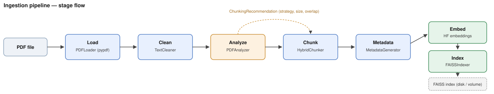

# Smart Document Ingestion Engine

> Turns PDF, Word, HTML and text files into a FAISS vector index for RAG. It analyses each document first and picks the chunk size, overlap and strategy from what it finds, instead of using one fixed setting.



Load → clean → analyse → chunk → generate metadata → embed → index.

This builds the index that [query_intelligence_llm](https://github.com/yugmint/query_intelligence_llm) answers questions from.

## What makes it different

- **Per-document chunking.** `PDFAnalyzer` classifies the document (e.g. research paper, invoice, general), measures paragraph and sentence lengths, and recommends a chunk size, overlap and strategy, with a 0–1 confidence score and a logged rationale. The chunkers use that recommendation rather than one global setting.
- **A real recursive splitter.** `RecursiveChunker` tries separators in priority order (paragraph → line → sentence → word → character), recurses into pieces that are still too large, packs small fragments back up towards the target size, then applies overlap. Tiny trailing fragments are merged, and oversized paragraphs are hard-split.
- **Quality checks for any document.** `scripts/validate_chunks.py` and `scripts/validate_embeddings.py` report chunk-size distribution, overlap, mid-sentence cuts, embedding health and a keyword hit-rate check (see below).
- **Defensive loading.** Missing files, encrypted PDFs, per-page extraction failures and image-only PDFs (which need OCR) raise a typed `IngestionError` with context instead of crashing the run.
- **Clean metadata.** `file_extension` ("pdf") and `document_type` ("research_paper") are separate fields, and each chunk carries its classification, chunking strategy and confidence.

## A bug the validation script caught

An early `RecursiveChunker` split text into pieces no larger than `chunk_size` but never recombined the small ones. On a PDF with many short extracted lines it produced **38 chunks averaging ~215 characters against a 630-character target (3% within range)**. Adding a greedy packing step (`RecursiveChunker._pack()`) brought the same document to **8 chunks averaging ~520 characters (75% within range)**. Re-running `validate_chunks.py` after any chunker change catches a regression like this immediately.

## Status

- **Loaders:** PDF, DOCX, HTML, plain text.
- **Chunking:** the recursive chunker is complete. `StructureChunker`, `SemanticChunker` and `MarkdownChunker` are **V1 fallbacks** that delegate to it. Heading-aware, embedding-similarity and markdown-aware splitting are on the [roadmap](docs/05-roadmap.md).
- **No OCR:** scanned, image-only PDFs are rejected with a clear error.
- **Indexing:** full builds plus incremental `add()`; refuses to write an empty index.
- **Tests:** 54 pytest tests, including an end-to-end run on a sample PDF.

## Configuration

`IngestionConfig` validates itself (for example `chunk_overlap < chunk_size`) and can be overridden with environment variables for containers: `INGESTION_CHUNK_SIZE`, `INGESTION_INDEX_PATH`, `INGESTION_EMBEDDING_MODEL` and others. Set `LOG_LEVEL` to control logging.

## Documentation

- [`DOCUMENTATION.md`](DOCUMENTATION.md) — full architecture and
  module-by-module reference.
- [`docs/`](docs/) — deeper-dive docs: [architecture](docs/01-architecture.md),
  [ingestion best practices](docs/02-ingestion-best-practices.md),
  [development guide](docs/03-development-guide.md),
  [contributing](docs/04-contributing.md), [roadmap](docs/05-roadmap.md),
  [release notes](docs/06-release-notes.md),
  [design decisions](docs/07-design-decisions.md).
- [`PATCH_NOTES.md`](PATCH_NOTES.md) — the specific patch that added e2e
  tests, the quality-validation scripts, and the chunk-packing fix.

## Running

```bash
pip install -r requirements.txt
python -m src.ingestion.pipeline path/to/file.pdf
```

### As a standalone API

To run it next to [query_intelligence_llm](https://github.com/yugmint/query_intelligence_llm)'s API, share one FAISS
index between the two containers through a mounted volume:

```bash
INGESTION_API_KEY=your-shared-secret uvicorn src.ingestion.api:app --reload --port 8000
curl -H "X-API-Key: your-shared-secret" -F "file=@path/to/file.pdf" http://localhost:8000/ingest
```

`INGESTION_API_KEY` is optional for local dev (omit it and the endpoint runs
unauthenticated with a warning) but required before exposing this beyond
localhost — this service shares a vector store with the RAG API, so an
unauthenticated `/ingest` can poison data the RAG side trusts.

See `docs/01-architecture.md` and `DOCUMENTATION.md` §9 for details.

## Testing

```bash
pip install pytest
pytest tests/ -v
```

## Validating chunk & embedding quality

Two standalone scripts under `scripts/` let you sanity-check a real
document without writing a one-off notebook every time.

### Chunking quality (no embedding model needed, fast/offline)

```bash
python scripts/validate_chunks.py path/to/file.pdf
python scripts/validate_chunks.py path/to/file.pdf --dump-samples 5
```

Reports: chunk-size distribution vs the recommended target, how many
chunks land within 0.5x-1.5x of that target, near-empty/duplicate
chunks, whether `chunk_overlap` is actually showing up between
consecutive chunks, and a "mid-sentence boundary" heuristic rate.
`--dump-samples N` prints N full random chunks so you can eyeball
them directly -- automated metrics catch structural problems, but
"does this chunk actually make sense on its own" still needs a human
read.

This is exactly how a real packing bug was caught during review: an
early version of `RecursiveChunker` split text into fragments <=
chunk_size but never recombined small fragments back up toward the
target -- on a PDF with lots of short extracted lines this produced
38 chunks averaging ~215 chars against a 630-char target (3% within
range). `RecursiveChunker._pack()` now greedily combines consecutive
fragments up to `chunk_size` before overlap is applied; the same
document now produces 8 chunks averaging ~520 chars (75% within
range). Re-run `validate_chunks.py` after any chunker change --
it'll catch a regression like this immediately.

### Embedding & retrieval quality (loads the real embedding model)

```bash
# Structural sanity: NaNs, zero vectors, norm distribution,
# near-duplicate embeddings, pairwise similarity spread.
python scripts/validate_embeddings.py path/to/file.pdf

# Retrieval smoke test: embed a real question, see what comes back.
python scripts/validate_embeddings.py path/to/file.pdf \
    --query "what does section 3 say about X?"

# Labeled hit-rate check over a small eval set you maintain:
python scripts/validate_embeddings.py path/to/file.pdf --eval eval_set.json
```

`eval_set.json` format:

```json
[
  {"query": "what chunking strategies were evaluated?", "expected_keyword": "chunking"},
  {"query": "who are the authors?", "expected_keyword": "author"}
]
```

This checks whether the expected keyword shows up anywhere in the
top-k retrieved chunks -- a lightweight proxy for recall@k that
doesn't require a fully labeled ground-truth dataset. It's meant to
grow over time: every time you find a retrieval failure worth
guarding against, add it as a case here.

Things worth specifically looking for in the output:
- **near-duplicate embeddings** across genuinely different chunks
  usually means chunks are too short/repetitive, or the wrong model
  is loaded.
- **norm mean far from 1.0** when `normalize_embeddings=True` means
  normalization isn't actually happening -- check the embedding
  factory wiring.
- **pairwise similarity mean > 0.9** across the whole document means
  the embedding space has no spread -- retrieval can't discriminate
  between chunks, which usually means something upstream is wrong
  (e.g. a broken tokenizer, or degenerate/near-identical chunks).

## Docker

Batch/CLI (one-shot container per document):

```bash
docker build -t ingestion .
docker run -v $(pwd)/data:/data -v $(pwd)/input_docs:/input ingestion /input/file.pdf
```

(`./input_docs` here is wherever you keep the PDFs you're ingesting — kept
distinct from `./docs/`, which is this repo's own documentation.)

Standalone API (long-running service, uses `Dockerfile.api` instead):

```bash
docker build -f Dockerfile.api -t ingestion-api .
docker run -p 8000:8000 -v $(pwd)/data:/data ingestion-api
```
