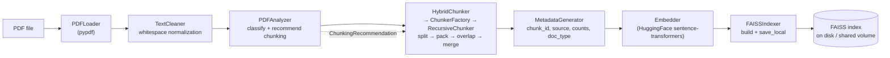
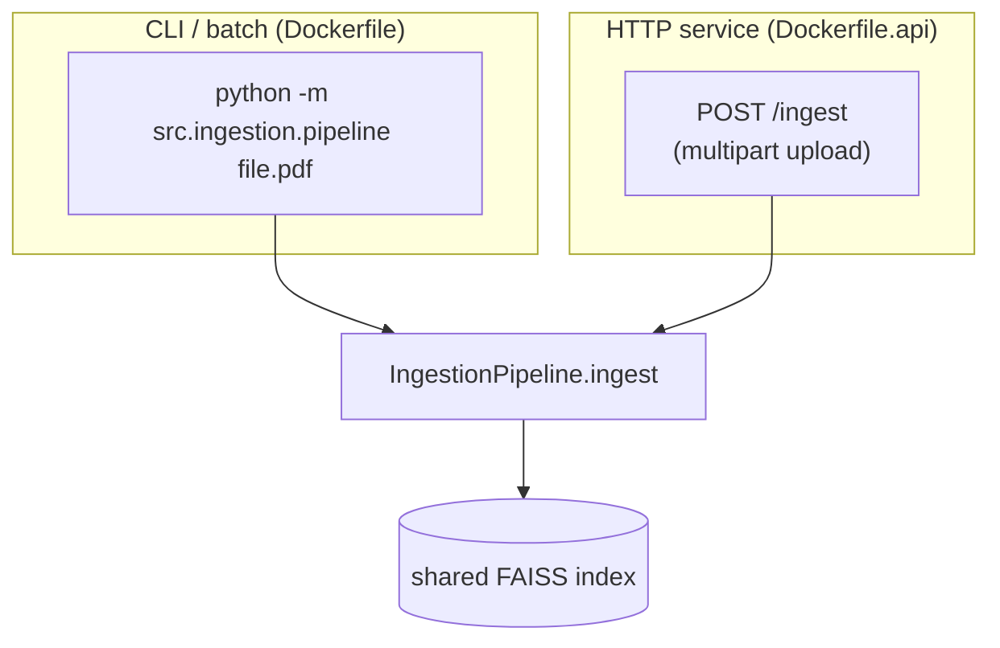

# 01 — Architecture

> For a full module-by-module reference, see [`DOCUMENTATION.md`](../DOCUMENTATION.md)
> at the repo root. This page is the shorter, diagram-first version.

## What this service does

Turns a document (currently: PDF) into a searchable FAISS index, with
per-document-type adaptive chunking instead of one fixed chunk size for
everything:

```
load → clean → analyze → chunk → generate metadata → embed → index
```

## Pipeline diagram

See [`assets/workflow.svg`](assets/workflow.svg) for the rendered version.
Mermaid source (renders directly on GitHub):



## Two entry points into the same pipeline



Both paths call the exact same `IngestionPipeline.ingest()` — the API
(`src/ingestion/api.py`) is a thin HTTP wrapper added for standalone service
deployment, not a second implementation. See §9 of `DOCUMENTATION.md` for
the deployment details and how this pairs with the separate `RAG_Project_1`
API over a shared volume.

## Why adaptive chunking

A fixed `chunk_size`/`chunk_overlap` applied uniformly to every PDF is the
naive baseline this pipeline deliberately avoids. `PDFAnalyzer` inspects each
document's statistics (paragraph/sentence length, word count) and layout
signals (headings, tables, lists, equations), classifies the document type
(`research_paper` / `book` / `legal` / `invoice` / `general`), and emits a
`ChunkingRecommendation` — strategy, chunk_size, chunk_overlap, and
merge/split flags — that overrides the static config defaults for that one
document. Rationale for each recommendation is logged, not just applied
silently. See `07-design-decisions.md` for why this approach was chosen over
a single global config.

## Stage responsibilities (one line each)

| Stage | Package | Responsibility |
|---|---|---|
| Load | `loaders/` | Parse raw bytes → per-page `Document` objects |
| Clean | `cleaners/` | Normalize whitespace/line endings |
| Analyze | `analysers/` | Classify document type, recommend chunking |
| Chunk | `chunkers/` | Split into retrieval-sized pieces per the recommendation |
| Metadata | `metadata/` | Attach chunk_id, source, counts, doc type to each chunk |
| Embed | `embedders/` | Produce vector embeddings via the configured model |
| Index | `indexers/` | Build and persist the FAISS index |

Every stage follows the same ABC + Factory shape (`base.py` + `factory.py` +
one or more concrete implementations), so adding a new document type or
chunking strategy means adding a class and registering it — not touching the
orchestrator (`pipeline.py`).

## Not part of this diagram (see roadmap)

`StructureChunker`, `SemanticChunker`, `MarkdownChunker` exist as registered
strategies but currently all delegate to `RecursiveChunker` — they're
placeholders, not implementations. See `05-roadmap.md`.
